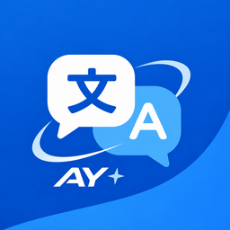
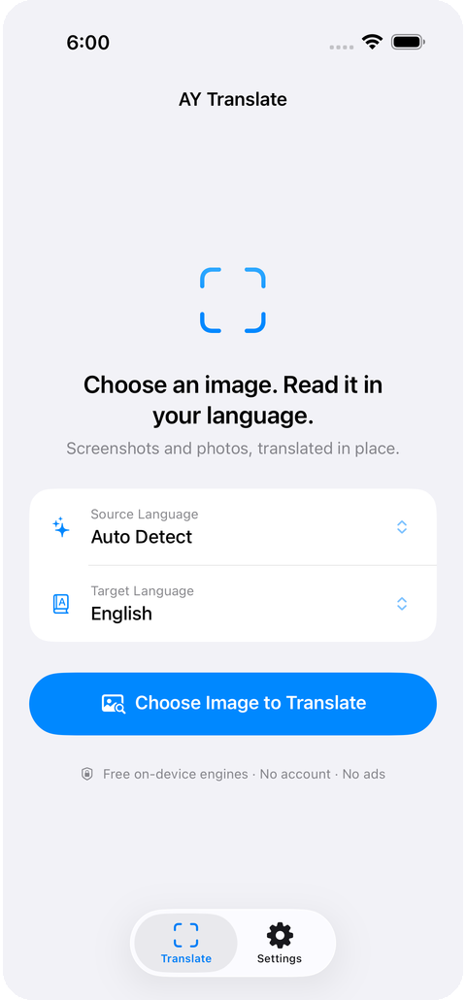
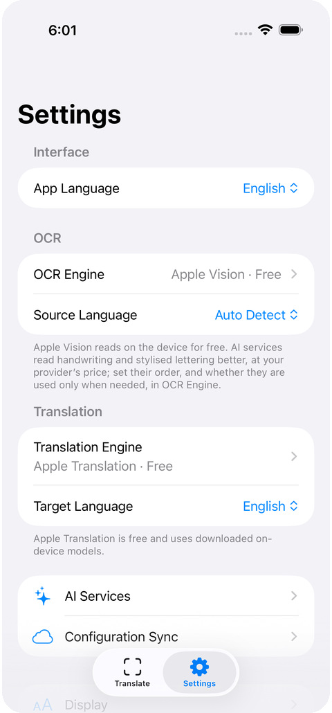
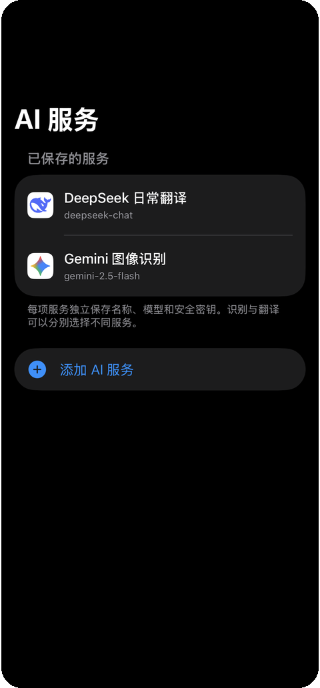

  <a href="README.md">简体中文</a> ·
  <b>English</b> ·
  <a href="README.es.md">Español</a> ·
  <a href="README.ja.md">日本語</a> ·
  <a href="README.ko.md">한국어</a>

  

<h1 align="center">AY Translate</h1>

  <strong>Read translations right where the original text was</strong> 
  iPhone · iPad&nbsp; | &nbsp;iOS / iPadOS 26.5+

  <a href="https://github.com/AtlanYuey/AY-Translate/releases/latest"><strong>Download latest release</strong></a> ·
  <a href="#features">Features</a> ·
  <a href="#get-started">Get started</a> ·
  <a href="#settings">Settings</a>

  
  
  

Translate · Settings · AI services. Screenshots from the iOS simulator with sample service configurations.

## Features

AY Translate lets you choose separate engines for text recognition and translation, then puts the result back into the screenshot. Read manga, game screens or web pages in context and switch to the original whenever you want to check it.

| Feature | What it does |
| --- | --- |
| In-place translation | Places translations using the position, size and direction of the original text. Manga dialogue is grouped by speech bubble, with support for vertical Japanese. |
| On-device by default | Uses Apple Vision and Apple Translation without an account or API key. The system may need to download language models on first use. |
| Your choice of AI services | Use Gemini, OpenAI, DeepSeek, OpenRouter and other compatible or self-hosted services. Set separate service orders for OCR and translation. If a service fails or reaches its spending limit, the next one takes over, with the on-device engine as the final fallback. |
| AI-assisted OCR | Start on-device and use AI only when the image needs a second pass, for example for handwriting, stylized lettering or missed text. You can ask the app to confirm before calling AI. |
| Screenshot shortcut | Bind the included shortcut to the Action button or Back Tap. Read the result over the app you were using. |
| Costs and privacy | Track usage and costs per service and set monthly limits. With your permission, AI OCR sends the image to the chosen provider and AI translation sends the recognized text. Saving history is optional. |

## Get started

1. Download the unsigned IPA from Releases. Sign **the main app and the share extension** with your certificate before installing. If your signing tool accepts a single provisioning profile, check that it covers both bundle IDs. [Signing guide in Chinese](docs/Signing-and-iCloud.md)
2. Open **Translate**, select the source and target languages, and tap **Choose Image to Translate**. You can also select AY Translate from the system share sheet.
3. To translate a screenshot, add the shortcut under **Settings → Quick Actions → Action Button & Shortcuts**, then assign it to the Action button or Back Tap in system settings.
4. To use AI, open **Settings → AI Services**, enter the endpoint, API key and model, test the service and add it to the order for the relevant engine.

Pinch and drag to explore the image, or double-tap to toggle zoom. Tap the bottom-right icon to switch between the original and translation. Touch and hold it to read the full text, copy either version, or check processing times and AI usage.

## Settings

| To change | Go to |
| --- | --- |
| App interface language | Settings → App Language |
| Source language, OCR engine, AI assistance and service order | Settings → OCR |
| Target language, translation engine and service order | Settings → Translation |
| Models, request parameters, OCR or translation tests, usage and costs | Settings → AI Services → Select a service |
| Text size, overlay style, initial result view and tap for details | Settings → Display |
| Save or clear history | Settings → Translation History |
| iCloud sync and configuration copying | Settings → Configuration Sync |
| Revoke cloud processing permission | Settings → Privacy |
| Version, processing diagnostics and open-source licenses | Settings → About AY Translate |

Apple Developer account holders can enable iCloud settings sync and separately opt in to syncing API keys. Screenshots and history stay out of iCloud sync. [iCloud setup in Chinese](docs/Signing-and-iCloud.md)

---

Based on Translate Screen by Bahaa and contributors. Released under Apache 2.0. [Upstream project](https://github.com/0xffvirus/translate-screen) · [License](LICENSE) · [Attribution and third-party notices](NOTICE)
