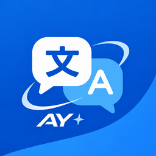
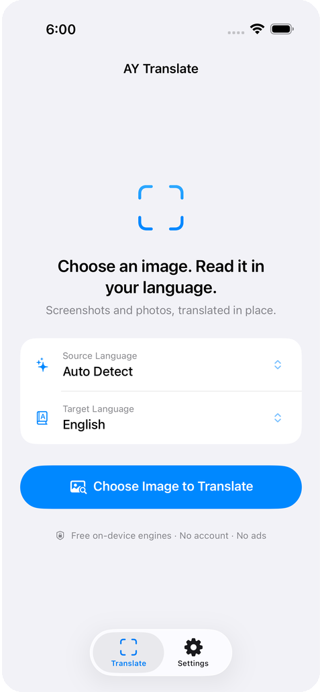
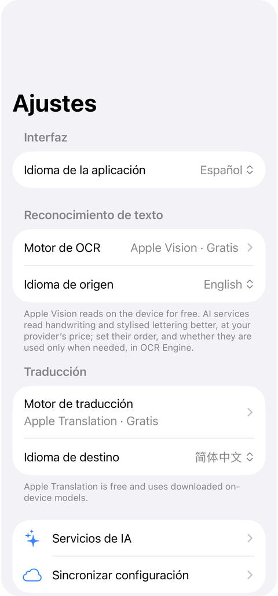
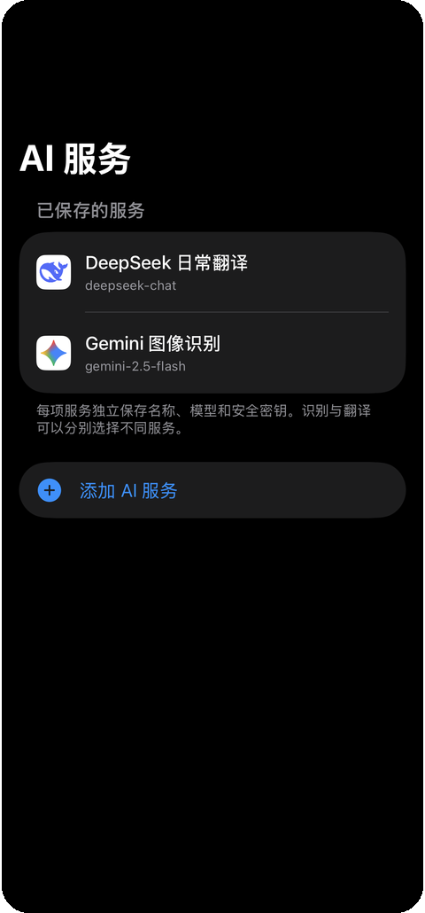

  <a href="README.md">简体中文</a> ·
  <a href="README.en.md">English</a> ·
  <b>Español</b> ·
  <a href="README.ja.md">日本語</a> ·
  <a href="README.ko.md">한국어</a>

  

<h1 align="center">AY Translate</h1>

  <strong>Lee la traducción en el mismo lugar que el texto original</strong> 
  iPhone · iPad&nbsp; | &nbsp;iOS / iPadOS 26.5+

  <a href="https://github.com/AtlanYuey/AY-Translate/releases/latest"><strong>Descargar la última versión</strong></a> ·
  <a href="#funciones">Funciones</a> ·
  <a href="#primeros-pasos">Primeros pasos</a> ·
  <a href="#ajustes">Ajustes</a>

  
  
  

Traducir · Ajustes · Servicios de IA. Capturas del simulador de iOS con configuraciones de ejemplo.

## Funciones

AY Translate te deja elegir por separado los motores de reconocimiento y traducción, y coloca el resultado sobre la captura. Puedes leer manga, pantallas de juegos o páginas web en su contexto y volver a la imagen original para comparar.

| Función | Qué puedes hacer |
| --- | --- |
| Traducción sobre la imagen | Lee el resultado en la posición, el tamaño y la orientación del texto original. En el manga, el texto se agrupa por bocadillos y admite japonés en vertical. |
| Procesamiento local por defecto | Usa Apple Vision y la traducción de Apple sin cuenta ni clave de API. La primera vez, el sistema puede pedirte que descargues los modelos de idioma. |
| Servicios de IA a tu elección | Usa Gemini, OpenAI, DeepSeek, OpenRouter u otros servicios compatibles, incluidos los que alojes tú. Ordena los servicios por separado para el OCR y la traducción. Si uno falla o alcanza su límite de gasto, se prueba el siguiente. El motor local queda como último recurso. |
| OCR con ayuda de IA | Empieza en el dispositivo y recurre a la IA cuando hace falta una segunda lectura, por ejemplo con texto manuscrito, letras decorativas o palabras omitidas. Puedes pedir que la app te consulte antes de usar la IA. |
| Atajo para capturas | Asigna el atajo incluido al botón de acción o a Tocar atrás y lee la traducción sobre la aplicación que estabas usando. |
| Coste y privacidad | Consulta el uso y el coste de cada servicio y fija límites mensuales. Con tu permiso, el OCR con IA envía la imagen al proveedor elegido y la traducción con IA envía el texto reconocido. Guardar el historial es opcional. |

## Primeros pasos

1. Descarga el IPA sin firmar desde la página de versiones. Firma **la aplicación principal y la extensión para compartir** con tu certificado antes de instalar. Si la herramienta acepta un solo perfil de aprovisionamiento, comprueba que cubra ambos identificadores de paquete. [Guía de firma en chino](docs/Signing-and-iCloud.md)
2. Abre **Traducir**, elige el idioma de origen y el de destino y toca **Elegir imagen para traducir**. También puedes seleccionar AY Translate en el menú Compartir de iOS.
3. Para traducir una captura, añade el atajo en **Ajustes → Acciones rápidas → Botón de acción y Atajos**. Después, asígnalo al botón de acción o a Tocar atrás en los ajustes del sistema.
4. Para usar IA, ve a **Ajustes → Servicios de IA**. Introduce la dirección del servicio, la clave de API y el modelo, prueba el servicio y añádelo a la lista del motor correspondiente.

Pellizca o arrastra la imagen para ver los detalles. Toca dos veces para alternar el zoom. Toca el icono inferior derecho para pasar del original a la traducción. Mantenlo pulsado para leer el texto completo, copiar cualquiera de las dos versiones o consultar los tiempos de procesamiento y el uso de IA.

## Ajustes

| Qué quieres cambiar | Dónde |
| --- | --- |
| Idioma de la interfaz | Ajustes → Idioma de la aplicación |
| Idioma de origen, motor de OCR, ayuda de IA y orden de servicios | Ajustes → Reconocimiento de texto |
| Idioma de destino, motor de traducción y orden de servicios | Ajustes → Traducción |
| Modelos, parámetros de solicitud, pruebas de OCR o traducción, uso y costes | Ajustes → Servicios de IA → Selecciona un servicio |
| Tamaño, estilo del texto, vista inicial y detalles al tocar | Ajustes → Visualización |
| Guardar o borrar el historial | Ajustes → Historial de traducción |
| Sincronizar con iCloud o copiar la configuración | Ajustes → Sincronizar configuración |
| Revocar permisos de procesamiento en la nube | Ajustes → Privacidad |
| Versión, diagnóstico y licencias de código abierto | Ajustes → Acerca de AY Translate |

Con una cuenta de Apple Developer puedes activar la sincronización de ajustes en iCloud y decidir por separado si quieres sincronizar las claves de API. Las capturas y el historial quedan fuera de la sincronización. [Configurar iCloud (en chino)](docs/Signing-and-iCloud.md)

---

Basado en Translate Screen, de Bahaa y sus colaboradores. Publicado con la licencia Apache 2.0. [Proyecto original](https://github.com/0xffvirus/translate-screen) · [Licencia](LICENSE) · [Créditos y avisos de terceros](NOTICE)
