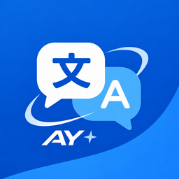
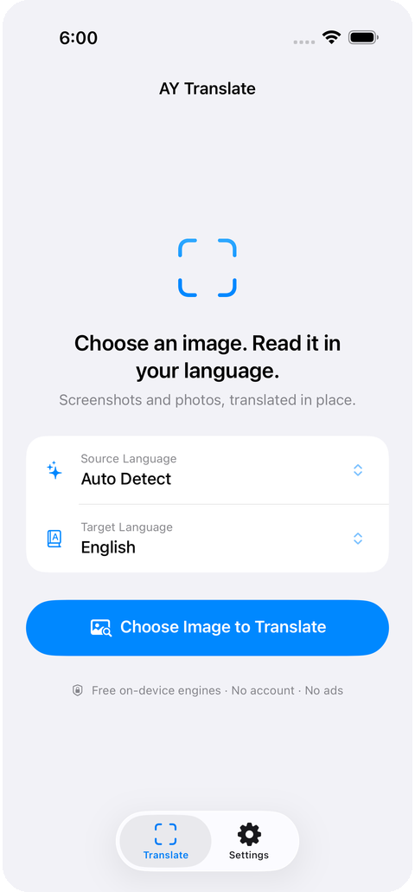
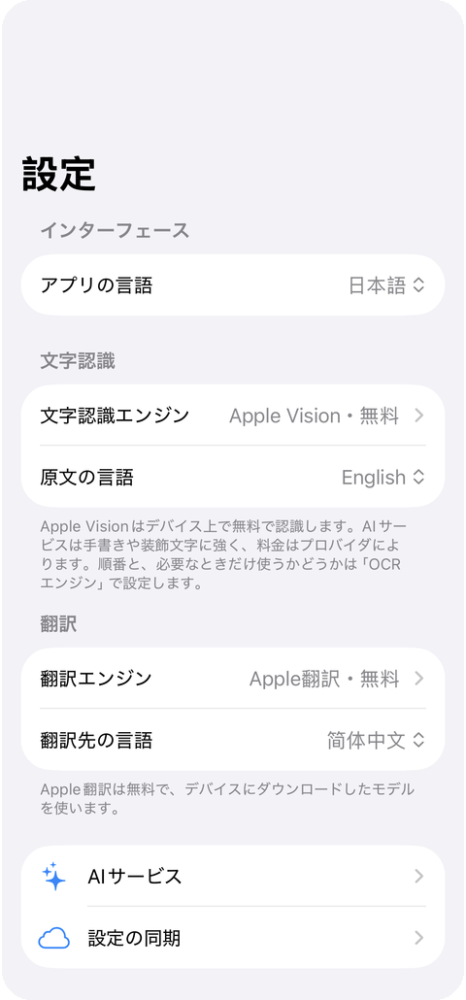
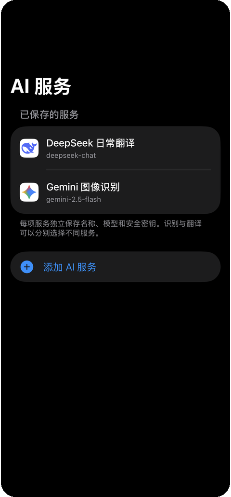

  <a href="README.md">简体中文</a> ·
  <a href="README.en.md">English</a> ·
  <a href="README.es.md">Español</a> ·
  <b>日本語</b> ·
  <a href="README.ko.md">한국어</a>

  

<h1 align="center">AY Translate</h1>

  <strong>元の画像の上で翻訳を読む</strong> 
  iPhone · iPad&nbsp; | &nbsp;iOS / iPadOS 26.5+

  <a href="https://github.com/AtlanYuey/AY-Translate/releases/latest"><strong>最新版をダウンロード</strong></a> ·
  <a href="#主な機能">主な機能</a> ·
  <a href="#使い方">使い方</a> ·
  <a href="#設定">設定</a>

  
  
  

翻訳画面 · 設定 · AIサービス。iOSシミュレーターで撮影した画面です。サービス設定はサンプルです。

## 主な機能

AY Translateでは、文字認識と翻訳のエンジンを個別に選び、翻訳文をスクリーンショットの元の位置に表示できます。マンガやゲーム画面、ウェブページを見ながら読み進め、必要なときに元画像に戻して確認できます。

| 機能 | できること |
| --- | --- |
| 元の位置に翻訳を表示 | 原文の位置・文字サイズ・向きに合わせて翻訳を配置します。マンガではセリフを吹き出しごとにまとめ、日本語の縦書きにも対応しています。 |
| デバイス上で処理 | 初期設定ではApple VisionとAppleの翻訳機能を使用します。アカウントやAPIキーは不要です。初回は言語モデルのダウンロードが必要な場合があります。 |
| AIサービスを選択 | Gemini、OpenAI、DeepSeek、OpenRouterなどの対応サービスや自前の互換APIを利用できます。文字認識と翻訳で別々に利用順を設定でき、エラーや利用上限に達した場合は次のサービスに切り替わります。最後はデバイス上のエンジンが処理します。 |
| AIによる文字認識の補助 | まずデバイス上で認識し、手書き文字や装飾文字、読み落としなど、再確認が必要な箇所がある場合にAIを使用できます。使用前に確認を表示する設定もあります。 |
| スクリーンショットのショートカット | 付属のショートカットをアクションボタンや背面タップに割り当て、使用中のアプリの上で翻訳結果を確認できます。 |
| 料金とプライバシー | サービスごとの使用量や料金を確認し、月間の利用上限を設定できます。許可した場合、選んだサービスに文字認識用の画像または翻訳用の認識済みテキストを送信します。履歴の保存は任意です。 |

## 使い方

1. リリースページから未署名のIPAをダウンロードします。自分の証明書で**本体アプリと共有機能拡張**に署名してからインストールします。署名ツールがプロビジョニングプロファイルを一つしか指定できない場合は、両方のバンドルIDが対象に含まれることを確認してください。[署名ガイド（中国語）](docs/Signing-and-iCloud.md)
2. 「翻訳」で原文の言語と翻訳先の言語を選び、「画像を選んで翻訳」をタップします。システムの共有メニューからAY Translateを選ぶこともできます。
3. スクリーンショットから起動するには「設定 → クイック操作 → アクションボタンとショートカット」でショートカットを追加し、システム設定でアクションボタンまたは背面タップに割り当てます。
4. AIを使うには「設定 → AIサービス」で接続先、APIキー、モデルを入力します。動作を確認してから、対応するエンジンの利用順に追加してください。

結果画面ではピンチやドラッグで細部を確認でき、ダブルタップで拡大表示を切り替えられます。右下のアイコンをタップすると元画像と翻訳結果が切り替わります。長押しすると全文表示、コピー、処理時間やAI使用量の確認ができます。

## 設定

| 変更したい項目 | 場所 |
| --- | --- |
| アプリの表示言語 | 設定 → アプリの言語 |
| 原文の言語、文字認識エンジン、AI補助とサービスの利用順 | 設定 → 文字認識 |
| 翻訳先の言語、翻訳エンジンとサービスの利用順 | 設定 → 翻訳 |
| モデル、リクエストの設定、認識・翻訳のテスト、使用量と料金 | 設定 → AIサービス → 対象のサービス |
| 文字サイズ、表示スタイル、結果の初期表示、タップ時の詳細表示 | 設定 → 表示 |
| 履歴の保存と削除 | 設定 → 翻訳履歴 |
| iCloud同期と設定のコピー | 設定 → 設定の同期 |
| クラウド処理の許可を取り消す | 設定 → プライバシー |
| バージョン、処理の診断、オープンソースライセンス | 設定 → AY Translateについて |

Apple Developerアカウントをお持ちの場合は、iCloudで設定を同期できます。APIキーの同期は別途選択でき、スクリーンショットと履歴は同期の対象外です。[iCloudの設定方法（中国語）](docs/Signing-and-iCloud.md)

---

BahaaとコントリビューターによるTranslate Screenをベースに、Apache 2.0ライセンスで公開しています。[元のプロジェクト](https://github.com/0xffvirus/translate-screen) · [ライセンス](LICENSE) · [著作者・第三者ライセンスの表記](NOTICE)
