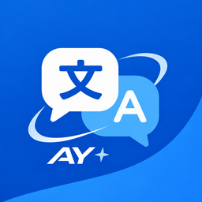
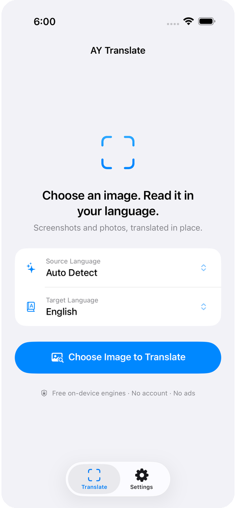
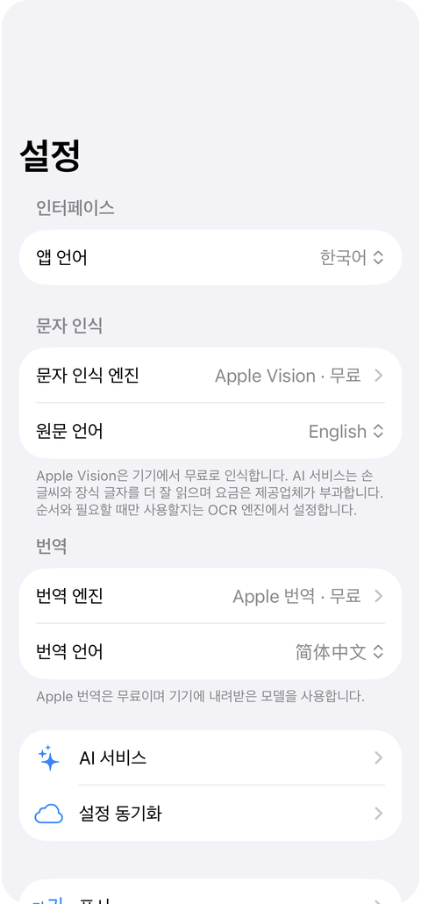
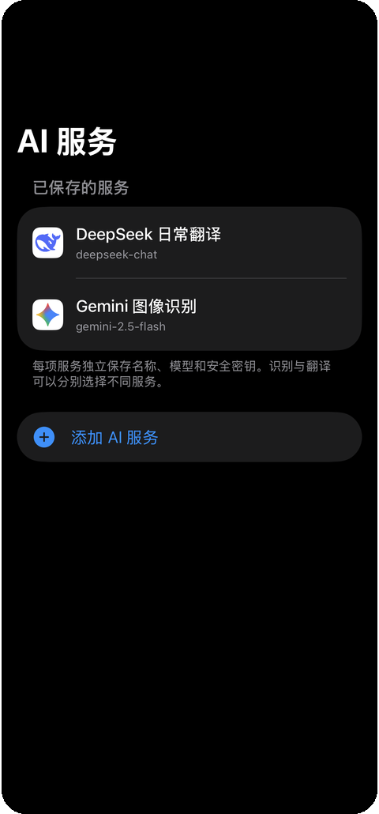

  <a href="README.md">简体中文</a> ·
  <a href="README.en.md">English</a> ·
  <a href="README.es.md">Español</a> ·
  <a href="README.ja.md">日本語</a> ·
  <b>한국어</b>

  

<h1 align="center">AY Translate</h1>

  <strong>원본 이미지에서 바로 번역문 읽기</strong> 
  iPhone · iPad&nbsp; | &nbsp;iOS / iPadOS 26.5+

  <a href="https://github.com/AtlanYuey/AY_Translate/releases/latest"><strong>최신 버전 다운로드</strong></a> ·
  <a href="#주요-기능">주요 기능</a> ·
  <a href="#시작하기">시작하기</a> ·
  <a href="#설정">설정</a>

  
  
  

번역 · 설정 · AI 서비스. iOS 시뮬레이터에서 캡처했으며 서비스 설정은 예시입니다.

## 주요 기능

AY Translate에서는 문자 인식 엔진과 번역 엔진을 따로 선택하고, 번역문을 스크린샷의 원래 위치에 표시할 수 있습니다. 만화, 게임 화면, 웹페이지를 맥락과 함께 읽다가 필요할 때 원본으로 전환해 비교할 수 있습니다.

| 기능 | 할 수 있는 일 |
| --- | --- |
| 이미지 위에 번역 표시 | 원문의 위치, 글자 크기, 방향에 맞춰 번역문을 배치합니다. 만화 대사는 말풍선 단위로 묶고 세로로 쓰인 일본어도 지원합니다. |
| 기본은 기기에서 처리 | Apple Vision과 Apple 번역을 사용합니다. 계정이나 API 키가 필요 없으며, 처음 사용할 때 언어 모델을 내려받아야 할 수 있습니다. |
| AI 서비스 선택 | Gemini, OpenAI, DeepSeek, OpenRouter 등 호환 서비스와 직접 운영하는 API를 연결할 수 있습니다. 문자 인식과 번역의 서비스 순서를 따로 설정합니다. 오류가 발생하거나 지출 한도에 도달하면 다음 서비스로 넘어가고, 마지막에는 기기 내 엔진이 처리합니다. |
| AI로 문자 인식 보조 | 기기에서 먼저 인식하고, 손글씨나 장식 글자, 누락된 문자를 다시 읽어야 할 때만 AI의 도움을 받도록 설정할 수 있습니다. AI를 쓰기 전에 확인을 요청하는 옵션도 있습니다. |
| 스크린샷 단축어 | 기본 제공 단축어를 동작 버튼이나 뒷면 탭에 연결해, 사용 중인 앱 위에서 번역 결과를 확인할 수 있습니다. |
| 비용과 개인정보 보호 | 서비스별 사용량과 비용을 확인하고 월 지출 한도를 설정할 수 있습니다. 허용한 경우 AI 문자 인식은 이미지를, AI 번역은 인식된 텍스트를 선택한 서비스에 보냅니다. 기록 저장은 선택 사항입니다. |

## 시작하기

1. 릴리스 페이지에서 서명되지 않은 IPA를 내려받습니다. 설치하기 전에 본인의 인증서로 **메인 앱과 공유 확장 프로그램**을 모두 서명하세요. 서명 도구에 프로비저닝 프로파일을 하나만 지정할 수 있다면 두 번들 ID를 모두 포함하는지 확인하세요. [서명 안내(중국어)](docs/Signing-and-iCloud.md)
2. **번역** 탭에서 원문 언어와 번역 언어를 정한 뒤 **번역할 이미지 선택**을 누릅니다. 시스템 공유 메뉴에서 AY Translate를 선택해도 됩니다.
3. 스크린샷을 바로 번역하려면 **설정 → 빠른 작업 → 동작 버튼 및 단축어**에서 단축어를 추가하고 시스템 설정에서 동작 버튼 또는 뒷면 탭에 연결합니다.
4. AI를 사용하려면 **설정 → AI 서비스**에서 서비스 주소, API 키, 모델을 입력합니다. 서비스를 테스트한 뒤 해당 엔진의 사용 순서에 추가하세요.

결과 화면에서 두 손가락으로 확대하거나 이미지를 드래그할 수 있습니다. 두 번 탭하면 확대 상태가 바뀝니다. 오른쪽 아래 아이콘을 눌러 원본과 번역을 전환하세요. 길게 누르면 전체 텍스트 읽기, 원문이나 번역 복사, 처리 시간과 AI 사용량 확인이 가능합니다.

## 설정

| 바꾸고 싶은 항목 | 위치 |
| --- | --- |
| 앱 인터페이스 언어 | 설정 → 앱 언어 |
| 원문 언어, 문자 인식 엔진, AI 보조 및 서비스 순서 | 설정 → 문자 인식 |
| 번역 언어, 번역 엔진 및 서비스 순서 | 설정 → 번역 |
| 모델, 요청 매개변수, 인식·번역 테스트, 사용량과 비용 | 설정 → AI 서비스 → 서비스 선택 |
| 글자 크기, 표시 스타일, 기본 결과 보기, 탭하여 상세 보기 | 설정 → 표시 |
| 기록 저장 또는 삭제 | 설정 → 번역 기록 |
| iCloud 동기화와 설정 복사 | 설정 → 설정 동기화 |
| 클라우드 처리 권한 철회 | 설정 → 개인정보 보호 |
| 버전, 처리 진단, 오픈 소스 라이선스 | 설정 → AY Translate 정보 |

Apple Developer 계정이 있다면 iCloud로 앱 설정을 동기화할 수 있습니다. API 키 동기화는 별도로 선택할 수 있으며 스크린샷과 기록은 동기화 대상에서 제외됩니다. [iCloud 설정 방법(중국어)](docs/Signing-and-iCloud.md)

---

Bahaa와 기여자들의 Translate Screen을 바탕으로 제작했으며 Apache 2.0 라이선스로 공개합니다. [원본 프로젝트](https://github.com/0xffvirus/translate-screen) · [라이선스](LICENSE) · [저작자 및 서드파티 고지](NOTICE)
