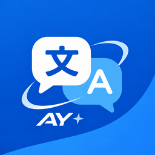
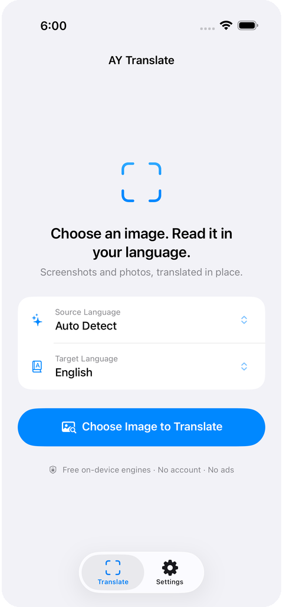
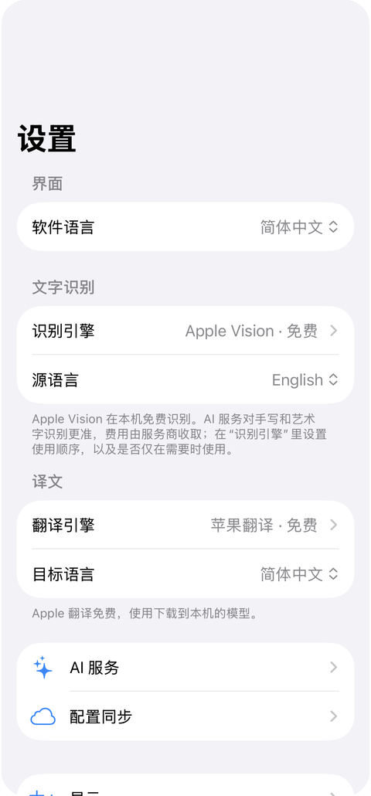
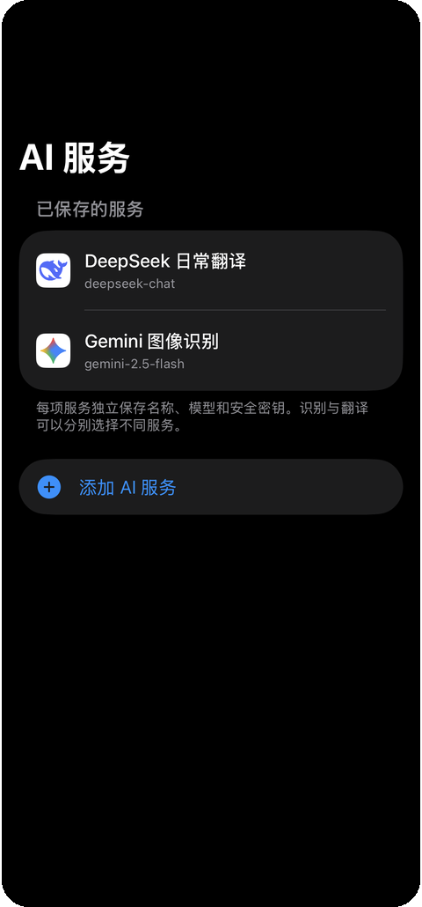

  <b>简体中文</b> ·
  <a href="README.en.md">English</a> ·
  <a href="README.es.md">Español</a> ·
  <a href="README.ja.md">日本語</a> ·
  <a href="README.ko.md">한국어</a>

  

<h1 align="center">AY Translate</h1>

  <strong>在原画面里读译文</strong> 
  iPhone · iPad&nbsp; | &nbsp;iOS / iPadOS 26.5+

  <a href="https://github.com/AtlanYuey/AY_Translate/releases/latest"><strong>下载最新版</strong></a> ·
  <a href="#功能一览">功能一览</a> ·
  <a href="#开始使用">开始使用</a> ·
  <a href="#设置入口">设置入口</a>

  
  
  

翻译首页 · 设置 · AI 服务。截图来自 iOS 模拟器，服务配置为示例。

## 功能一览

AY Translate 可以分别选择文字识别和翻译引擎，再把译文放回截图里。阅读漫画、游戏界面或网页时，可以保留画面的上下文，随时切换原图核对。

| 功能 | 实际体验 |
| --- | --- |
| 原位翻译 | 结合原文的位置、字号和方向排版。翻译漫画时按气泡组织句子，支持竖排日文。 |
| 默认在本机处理 | 使用 Apple Vision 和苹果翻译，无需账号或 API 密钥。首次使用可能需要下载语言模型。 |
| 自选 AI 服务 | 支持 Gemini、OpenAI、DeepSeek、OpenRouter 等服务和自建兼容接口。识别与翻译各自排序，失败或达到花销上限时依次切换，最后由本机引擎接手。 |
| AI 辅助识别 | 可以先用本机识别，只在手写字、艺术字或漏字等情况需要补读时使用 AI，也可以设置为调用前询问。 |
| 截图快捷翻译 | 将内置快捷指令绑定到操作按钮或轻点背面，在当前应用上方查看结果。 |
| 费用与隐私 | 可查看各服务的用量和费用并设月度上限。授权后，AI 识别会将图片发给所选服务，AI 翻译会发送识别出的文字。历史记录可按需开启。 |

## 开始使用

1. 从发布页下载未签名的 IPA，用自己的证书为**主应用和分享扩展**签名后安装。若使用只接受一份描述文件的签名工具，需确认描述文件同时覆盖两个 Bundle ID。[签名配置方法](docs/Signing-and-iCloud.md)
2. 打开「翻译」，选好源语言和目标语言，然后点击「选择图片翻译」。也可以在系统分享菜单中选择 AY Translate。
3. 想用截图触发，在「设置 → 快捷操作 → 操作按钮与快捷指令」添加截图翻译指令，再到系统设置绑定操作按钮或轻点背面。
4. 想用 AI，在「设置 → AI 服务」添加接口地址、API 密钥和模型，测试后加入相应引擎的使用顺序。

在结果页双指缩放、拖动查看细节，双击切换缩放。点击右下角图标切换原图和译图，长按可读全文、复制原文或译文，以及查看处理耗时和 AI 用量。

## 设置入口

| 想调整什么 | 在哪里 |
| --- | --- |
| 软件界面语言 | 设置 → 软件语言 |
| 源语言、识别引擎、AI 辅助与使用顺序 | 设置 → 文字识别 |
| 目标语言、翻译引擎与使用顺序 | 设置 → 译文 |
| 模型、请求参数、识别或翻译测试、用量和费用 | 设置 → AI 服务 → 选择服务 |
| 译文字号、显示样式、默认结果、点字详情 | 设置 → 显示 |
| 保存或清空历史 | 设置 → 翻译历史 |
| iCloud 同步、配置复制 | 设置 → 配置同步 |
| 撤销云端调用许可 | 设置 → 隐私 |
| 版本、处理诊断、开源许可 | 设置 → 关于 AY Translate |

有 Apple 开发者账号的用户可以开启 iCloud 设置同步，并单独选择是否同步 API 密钥。截图和历史不参与同步。[iCloud 配置方法](docs/Signing-and-iCloud.md)

---

基于 Bahaa 及贡献者的 Translate Screen，采用 Apache 2.0 许可证。[上游项目](https://github.com/0xffvirus/translate-screen) · [许可证](LICENSE) · [署名与第三方许可](NOTICE)
