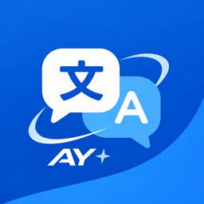

# AY Translate

面向 iPhone 和 iPad 的截图翻译工具：识别图片中的文字，在原位置显示译文，随时切换原图对照。

## 下载与安装

从 [Releases](https://github.com/AtlanYuey/AY-Translate/releases/latest) 下载 `AY-Translate-1.0.0-unsigned.ipa`，使用 Feather 等工具和自己的有效 Apple 签名安装。最低要求为 **iOS / iPadOS 26.5**。未签名 IPA 需要签名后才能安装；本仓库不提供签名证书。

首个正式版本为 **1.0.0**。此前 1.x 开发测试包属于旧应用身份，不代表本仓库的正式发布版本。

## 功能

- Apple Vision 本机文字识别与 Apple 翻译，默认无需 API Key。
- 日文竖排、分块文字合并和本机交叉查漏；无法保证任意图片或极小、模糊文字都完全识别。
- 多个 OpenAI 兼容 AI 服务，可分别选择识别和翻译模型；支持模型列表、参数预设、自定义参数和测试。
- 按文字笔画处理原文背景，译文位置和字号自适应，支持描边、原图对照、全文阅读及原生缩放。
- “覆盖显示未变化的原文”开关，可查看原本已是目标语言的已识别文字。
- 随包提供蓝色“AY Translate”截屏快捷指令，可自行绑定操作按钮或轻点背面。
- 可选翻译历史、可选文字详情、中文等多语言界面，以及 iPhone/iPad 横竖屏布局。
- 开启 iCloud 后自动同步语言、显示设置和 AI 服务定义；密钥、截图、历史及云端调用许可保留在本机。

## 使用

1. 打开应用，选择目标语言；使用苹果翻译时按系统提示下载所需语言模型。
2. 从照片选择图片，或通过系统分享将截图发送到 AY Translate。
3. 在“设置 → 快捷操作”导入内置快捷指令，并在系统中绑定操作按钮等触发方式。
4. 使用 AI 时先在“设置 → AI 服务”添加服务、密钥和模型，并进行文字/图片识别测试。

iOS 的系统分享宿主有时以卡片展示扩展。快捷指令导入和硬件触发器绑定需要用户在系统界面确认。

## iCloud 与签名

- 主应用 Bundle ID：`com.atlanyuey.translate`
- 分享扩展：`com.atlanyuey.translate.ShareExtension`
- App Group：`group.com.atlanyuey.translate`
- 共享钥匙串组：`$(AppIdentifierPrefix)com.atlanyuey.translate`
- iCloud 键值存储：`$(TeamIdentifierPrefix)com.atlanyuey.translate`

本项目使用 `NSUbiquitousKeyValueStore`，不使用 CloudKit 数据库，也不需要另建 `iCloud.com…` CloudKit 容器。需要在 Apple Developer 中为显式 App ID 配置 iCloud 键值存储能力，并让签名描述文件保留对应权限。只有填写 Bundle ID 并不能开通 iCloud。各设备需使用同一 iCloud 账号和匹配的签名身份；Feather 或签名服务若移除该权限，应用不能自行补回。

在“设置 → 配置同步”开启 iCloud 后，保存的设置和后续更改会自动排队同步，手动上传仅为备用入口。跨设备实际同步仍由系统、网络和签名权限决定。

## 从旧测试版迁移

新 ID 与旧测试版相互隔离，正式版可与旧版并存。在旧版“设置 → 配置同步 → 复制配置与 API 密钥”中复制，随即打开新版的同一页面导入。配置只在本机剪贴板保留 60 秒；导入后重新确认云端调用许可。旧快捷指令指向旧 ID，请导入正式版随附的快捷指令。

## 开发与构建

使用 Xcode 26.6 或提供兼容 SDK 的更新版本打开 `ScreenTranslate.xcodeproj`。选择自己的开发团队，注册上述 App ID、App Group 和能力后编译。工程内部保留部分 `ScreenTranslate` 文件/目标名称，以保留上游历史；对外名称为 AY Translate。

核心测试：`swift test --jobs 3`。Apple CI 另外运行实际 Vision 识别、iPhone 流程、连续分享和 iPad 横竖屏测试。`v*` 标签在全部检查通过后生成 GitHub Release。快捷指令源模板在 `Shortcuts/`，本地重新签名可使用 `tools/sign-shortcut.sh`；CI 验证签名归档与源模板一致。

[首发说明](docs/releases/1.0.0.md) · [签名与 iCloud 配置](docs/Signing-and-iCloud.md) · [修改声明](MODIFICATIONS.md)

## 开源来源与许可

AY Translate 由 AtlanYuey 维护，基于 Bahaa 和贡献者开发的 [Translate Screen](https://github.com/0xffvirus/translate-screen) 修改，独立发布，不代表原作者背书。

代码以 [Apache License 2.0](LICENSE) 发布，并保留原项目 [NOTICE](NOTICE)。主要修改见 [MODIFICATIONS.md](MODIFICATIONS.md)。服务商图标包含 LobeHub Icons，遵循 [MIT 许可](docs/ProviderIcons-LICENSE)；这些品牌图标仅用于识别对应服务。Yomogi 字体仅用于测试，其 SIL OFL 1.1 随测试资源保留，不包含在安装包中。应用“关于 → 开源许可”也提供相关声明。

AY Translate is an independent Apache-2.0 derivative of Translate Screen. Original attribution and third-party licenses are retained in the repository and distributed app.
